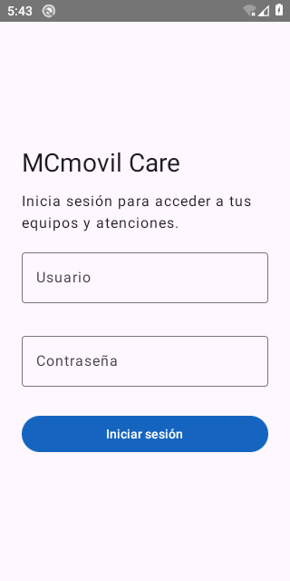

# 1. Nombre del proyecto

**MCmovil Care** — Evaluación Parcial 4 (Experiencia 3), DSY1105 Desarrollo de Aplicaciones Móviles.

MVP académico del seguimiento del ciclo de vida de equipos: app Android (Kotlin + Jetpack Compose) conectada a dos microservicios Spring Boot propios y a una API externa de feriados. Solo usa datos ficticios; no se conecta a Gestioo.

# 2. Integrantes

- Alejandrina Farias
- Camila Castillo

Equipo N°: _(completar con el número asignado en el curso)_

# 3. Funcionalidades

- Inicio con contadores calculados a partir de los registros y aviso de autorizaciones pendientes.
- Equipos: crear, consultar, editar y eliminar desde la interfaz.
- Atenciones: crear, consultar, editar y eliminar; estados, cotización ficticia, autorización/rechazo, historial, informe, garantía y próxima mantención.
- Evidencias: captura con cámara o selección, vista previa, carga real al servicio de atenciones y consulta de la imagen guardada.
- Login obligatorio y roles validados en servidor. Perfil de contacto independiente, de almacenamiento local y con validación por campo.
- Preferencia local persistente para mostrar diagnósticos.
- Agenda con feriados reales de Chile desde Nager.Date, vía Retrofit desde Android; cálculo de día hábil nacional de referencia y mantenciones ya registradas. Los feriados regionales se distinguen y no se tratan como nacionales.
- Room conserva copia de equipos/atenciones para consulta sin conexión. Sin conexión se deshabilitan los cambios remotos: no se afirma que exista una cola de sincronización. Perfil y preferencia se conservan localmente.
- Estados de carga, errores, reintento, validación por campo, confirmación de borrado y animación de detalles.

## Organización y arquitectura

- `android/app`: Compose/Material 3, navegación, adaptación al ancho disponible, CareViewModel, cámara, FileProvider y adaptador Room.
- `logic`: **lógica activa compartida**, utilizada por CareViewModel: modelos, validaciones, contratos Retrofit, RemoteCareRepository y CareController (estado y acciones asíncronas). No es un ejemplo independiente sin conexión con la app.
- `services/catalogo`: aplicación Spring Boot independiente y H2 propia de equipos.
- `services/atenciones`: aplicación Spring Boot independiente y H2 propia de atenciones/historial; archivos de evidencias en su volumen.
- `verificacion-logica`: ejecuta los mismos fuentes Kotlin de logic mediante Maven, con Kotest/MockK/coroutines-test y JaCoCo; no mantiene copias alternativas de la lógica.

Las bases están en `services/catalogo/datos` y `services/atenciones/datos`. No las borres si deseas conservar registros. Los tests usan otras bases en memoria. Las fotos están en `services/atenciones/datos/evidencias`.

## Acceso de demostración

Al abrir la app solo aparece **Iniciar sesión**. Inicia los dos servicios antes de ingresar:

| Usuario | Contraseña ficticia | Uso |
|---|---|---|
| `cliente` | `ClienteDemo26!` | Gestiona equipos, crea y consulta solicitudes y responde cotizaciones. |
| `tecnico` | `TecnicoDemo26!` | Consulta equipos y actualiza estados, informes y evidencias de las atenciones. |
| `admin` | `AdminDemo26!` | Accede al conjunto de operaciones para la demo. |

Son cuentas de prueba preconfiguradas; no existe registro de usuarios ni administración de cuentas desde la app. Los roles operan sobre un conjunto compartido de datos ficticios (no hay aislamiento de múltiples clientes reales). No uses información real ni expongas esta demo públicamente. Puedes cambiar las contraseñas en el servidor con las variables MCCARE_CLAVE_CLIENTE, MCCARE_CLAVE_TECNICO y MCCARE_CLAVE_ADMIN.

Catálogo comprueba las credenciales y devuelve un token temporal. Retrofit lo envía a las dos API propias en `Authorization: Bearer ...`; nunca se adjunta al servicio externo de feriados. Ambos servicios bloquean el acceso anónimo a los datos. Los permisos se validan en el backend además de reflejarse en la interfaz. El token no se guarda en Room: si se cierra el proceso de la app o se reinicia Catálogo, hay que ingresar otra vez. La sesión del servidor vence en 8 horas o al recibir el cierre de sesión. Si cierras sin conexión, el cierre local es inmediato y el servidor conserva esa sesión hasta que venza.

# 4. Endpoints utilizados

Catálogo: `http://localhost:8081/`
- GET `/api/salud` (público)
- POST `/api/sesion`: recibe usuario/clave y responde token, usuario y rol.
- GET `/api/sesion`: identifica la sesión activa.
- DELETE `/api/sesion`: revoca la sesión.
- GET/POST `/api/equipos`
- GET/PUT/DELETE `/api/equipos/{id}`

Atenciones: `http://localhost:8082/`
- GET `/api/salud`
- GET/POST `/api/atenciones`
- GET/PUT/DELETE `/api/atenciones/{id}`
- PATCH `/api/atenciones/{id}/autorizacion`
- POST `/api/evidencias` (multipart, campo archivo)
- GET `/api/evidencias/{nombre}`
- GET `/internal/equipos/{id}/en-uso` (comprobación entre servicios)

La creación/edición de atención consulta el catálogo. El borrado de equipo consulta las referencias de atenciones; devuelve 409 si hay referencias y 503 si no puede comprobarlas. No se simulan dos servicios dentro de una única base: son dos procesos y dos almacenes. Esta demostración no implementa transacciones distribuidas ni coordinación de carreras concurrentes entre procesos.

API externa: `https://date.nager.at/api/v3/PublicHolidays/{año}/CL`. Se consulta directamente con Retrofit desde la pantalla Agenda. No guarda ni reemplaza datos del negocio. Si falla, las otras pantallas siguen funcionando; el cálculo advierte cuando solo está excluyendo fines de semana. No planifiques años distintos del que muestra la consulta.

# 5. Pasos para ejecutar

1. Extrae el ZIP COMPLETO; no copies solo android. La raíz debe mostrar android, logic, services, firma-demo, entrega y pom.xml.
2. En esa raíz, escribe `powershell` en la barra de direcciones del Explorador. Ejecuta `.\Iniciar-Servicios.ps1`. Descarga Maven si falta y selecciona un JDK completo >=21; evita el acceso de Oracle javapath. No cambia la configuración global del PC. Los puertos son **8081 y 8082**, no 8080.
3. Abre `http://localhost:8081/api/salud` y `http://localhost:8082/api/salud`. Ambos deben devolver OK.
4. Enciende un emulador Android API 26 o superior, o conecta un teléfono con depuración USB. Ejecuta `.\Instalar-APK.ps1`. Ese script conecta ambos puertos mediante `adb reverse`, instala el APK firmado incluido y lo abre. Es necesario repetir el reverse tras desconectar el teléfono/emulador.
5. Si quieres editar el código, abre **la carpeta android** en Android Studio, no la raíz de entrega. Espera el Sync y ejecuta app. Debug tiene un applicationId diferente para poder coexistir con release y con la entrega anterior.
6. Al terminar: `.\Detener-Servicios.ps1` detiene solo los procesos registrados por este proyecto.

Si PowerShell bloquea scripts y la política del instituto lo permite, usa `Set-ExecutionPolicy -Scope Process Bypass` solo en esa ventana. No hace falta ejecutarlo si ya están permitidos. Si una directiva institucional lo impide, no se modifica esa directiva: ejecuta los comandos Maven y Java equivalentes desde el IDE/terminal autorizado.

## Requisitos técnicos

- Backend: JDK completo 21 o superior. Para probar o reconstruir Android desde Gradle usa JDK 21 (o el JBR 21 de Android Studio) y configura JAVA_HOME. Un JDK 25 puede servir para iniciar el backend y probar el APK ya firmado.
- Android: Gradle 8.13, AGP 8.13.2, Kotlin 2.2.21, compileSdk/targetSdk 35, minSdk 26. Se abandonaron los números futuros del ZIP anterior para poder comprobar la compilación.
- Android Studio con SDK Platform 35, Build Tools 35.0.0 y Platform Tools. El APK ya incluido no necesita compilarse para instalarlo.
- Internet para la API externa y las descargas iniciales. Los microservicios locales no requieren internet una vez construidos.

## Prueba manual de todos los flujos

1. Abre la app: solo debe aparecer el login. Prueba una contraseña inválida y luego entra como cliente. Registra tus datos ficticios de contacto y comprueba el resumen.
2. Registra un equipo (nombre, marca, modelo, serie, estado y diagnóstico).
3. Edítalo y comprueba el cambio tras Actualizar.
4. Crea una atención para ese equipo. Prueba primero descripción corta y correo inválido.
5. Adjunta una foto ficticia pequeña; guarda y abre los detalles para comprobarla desde el servidor.
6. Pulsa **Salir** y entra como técnico. En **Editar atención**, cambia el estado a Cotizada y agrega el monto y el informe. Guarda.
7. Cierra la sesión técnica y vuelve a entrar como cliente. Autoriza desde la tarjeta. Verifica el historial y el contador de pendientes.
8. Edita estado, garantía y próxima mantención. Consulta Agenda y sus feriados.
9. Cambia la preferencia de diagnósticos; cierra y abre la app.
10. Detén y reinicia ambos servicios; vuelve a entrar. Los registros e historial deben permanecer.
11. Prueba eliminar el equipo con atención: debe impedirse. Elimina atención y luego equipo.
12. Después de haber cargado datos, detén servicios y pulsa Actualizar: debe mostrar copia local y bloquear edición. Enciéndelos y reintenta.

La eliminación de atenciones no borra inmediatamente las imágenes huérfanas del servidor. La demo limita archivos a 5 MiB y valida que sean imágenes; no incluye una política de limpieza de archivos ni un almacenamiento cloud de evidencias.

## Tests y cobertura

`.\Ejecutar-Pruebas.ps1` ejecuta la suite Maven y el control de cobertura Gradle. Con emulador: `.\Ejecutar-Pruebas.ps1 -ConInterfaz`.

Herramientas: Kotest para lógica, MockK para dependencias reemplazadas, coroutines-test para asincronía y JUnit Jupiter/MockMvc para backend. Las pruebas de pantalla usan **JUnit 4 con ComposeTestRule**, como en la guía de Android. JUnit Jupiter se utiliza en el backend.

JaCoCo comprueba automáticamente mínimo **80% de líneas** en cada módulo lógico. Se incluyen controlador, validaciones y repositorio; los DTO/entidades sin reglas y puntos de arranque se excluyen de forma explícita. **La cifra de logic incluye LoginController pero no la interfaz Compose ni los adaptadores Android de Room/cámara**; esos componentes se comprueban con compilación, tests de UI y pruebas de integración/manuales. Ver `VERIFICACION.md` para los números realmente obtenidos, alcance y limitaciones. No se presenta número de tests como porcentaje de cobertura.

Informes Maven: `services/*/target/site/jacoco/index.html` y `verificacion-logica/target/site/jacoco/index.html`. Informe Gradle: `logic/build/reports/jacoco/test/html/index.html`. XML y resultados originales conservados en `evidencias`.

# 6. Captura del APK firmado y .jks

Archivos de la entrega:

- APK firmado (release): `entrega/MCmovilCare-EVA4-release.apk`
- Llave de firma: `firma-demo/mccare-academico.jks` (alias, contraseñas en `firma-demo/CLAVES_SOLO_ENTREGA_PRIVADA.txt`)
- Configuración técnica: `android/keystore.properties` y bloque `signingConfigs` en `android/app/build.gradle.kts`
- Verificación completa: `entrega/verificacion-firma.txt`, `entrega/informacion-apk.txt`, `entrega/SHA256SUMS.txt`

Configuración de firma en `android/app/build.gradle.kts`:

```kotlin
signingConfigs { create("entrega") {
    storeFile = rootProject.file(firma.getProperty("storeFile"))
    storePassword = firma.getProperty("storePassword")
    keyAlias = firma.getProperty("keyAlias")
    keyPassword = firma.getProperty("keyPassword")
    storeType = "JKS"
} }
buildTypes { release { isMinifyEnabled = false; signingConfig = signingConfigs.getByName("entrega") } }
```

Verificación del APK con `apksigner verify --print-certs -v`:

```
Verifies
Verified using v1 scheme (JAR signing): false
Verified using v2 scheme (APK Signature Scheme v2): true
Verified using v3 scheme (APK Signature Scheme v3): false
Verified using v3.1 scheme (APK Signature Scheme v3.1): false
Verified using v4 scheme (APK Signature Scheme v4): false
Verified for SourceStamp: false
Number of signers: 1
Signer #1 certificate DN: CN=MCmovil Care Demo Academica, OU=EVA4, O=Proyecto Estudiantil, C=CL
Signer #1 certificate SHA-256 digest: 6864be58984e7009edab3ab2ed645e3a30b4644730f97dd6748d093c52b808ef
Signer #1 certificate SHA-1 digest: 5910985b3a3d7fd1e8f763261fa76eea52e3678f
Signer #1 certificate MD5 digest: 8e019da302cdb401918a8b3aaea53bfe
Signer #1 key algorithm: RSA
Signer #1 key size (bits): 3072
Signer #1 public key SHA-256 digest: 357adf6bf37c646ea794e42dc8e5eea1f6a46ca8772578a198c5373e033277de
Signer #1 public key SHA-1 digest: 46c9a99c47a02aec6994c4785b727e47ff870c14
Signer #1 public key MD5 digest: bad228988a190cdf72b2041c33ec8fa5
```

Datos del APK (`aapt dump badging`):

```
package: name='com.example.appmcmovilcare_castillo_farias.eva4' versionCode='5' versionName='4.1' platformBuildVersionName='15' platformBuildVersionCode='35' compileSdkVersion='35' compileSdkVersionCodename='15'
sdkVersion:'26'
targetSdkVersion:'35'
launchable-activity: name='com.example.appmcmovilcare_castillo_farias.MainActivity'  label='' icon=''
```

Certificado público del `.jks` (`keytool -list -v`, sin contraseñas):

```
Alias name: mccare-demo
Creation date: Nov 20, 2026
Entry type: PrivateKeyEntry
Certificate chain length: 1
Certificate[1]:
Owner: CN=MCmovil Care Demo Academica, OU=EVA4, O=Proyecto Estudiantil, C=CL
Issuer: CN=MCmovil Care Demo Academica, OU=EVA4, O=Proyecto Estudiantil, C=CL
Serial number: f868f1ec71425bf5
Valid from: Fri Nov 20 15:46:15 CLST 2026 until: Mon Nov 20 15:46:15 CLST 2056
Certificate fingerprints:
	 SHA1: 59:10:98:5B:3A:3D:7F:D1:E8:F7:63:26:1F:A7:6E:EA:52:E3:67:8F
	 SHA256: 68:64:BE:58:98:4E:70:09:ED:AB:3A:B2:ED:64:5E:3A:30:B4:64:47:30:F9:7D:D6:74:8D:09:3C:52:B8:08:EF
Signature algorithm name: SHA384withRSA
Subject Public Key Algorithm: 3072-bit RSA key
Version: 3
```

Huellas SHA-256 de los entregables:

```
57ab86fd2bcc172f626bb45a7c592b03fa90038e7f9d9cd30e6d99d394b8c736  entrega/MCmovilCare-EVA4-release.apk
e682ee06395249d057523b73c876360307ef5abfb144d4a4c94d0f770dd81987  firma-demo/mccare-academico.jks
```

Pantalla de login del APK release instalado en emulador: `evidencias/pantalla-login-emulador.png`



El orden es debug > pruebas > release. El APK firmado de `entrega` está preparado para **demostración local con adb reverse**. El servidor no está incluido en el APK. Sin los dos servicios ejecutándose en el PC y sin el reverse no puede escribir datos remotos. La API externa sí necesita internet en el dispositivo.

`firma-demo/mccare-academico.jks` es una identidad NUEVA y **exclusivamente académica**. Tiene contraseñas distintas para almacén y clave y certificado de aproximadamente 30 años. El alias y contraseñas están en el archivo privado de esa carpeta; no las pegues en README ni en capturas. Android usa android/keystore.properties, ya preparado para la demo. Certificado y huella pública: firma-demo/certificado-publico.txt.

La llave y sus contraseñas se incluyen para tu respaldo y entrega PRIVADA al docente. `.gitignore` evita publicar accidentalmente la clave y contraseñas en un repositorio público. Si el docente exige adjuntar la llave, entrégala por el canal académico acordado; la captura y el certificado público pueden estar en README. No reutilices esta firma o credenciales en aplicaciones productivas.

Para reconstruir: `.\Generar-Release.ps1`. Ese script ejecuta tests antes de generar; la tarea preReleaseBuild también exige firma y cobertura del núcleo. Para un servidor alojado: usa los parámetros -CatalogoUrl y -AtencionesUrl con URL HTTPS reales terminadas en /. No hay URL cloud inventada ni despliegue externo efectuado.

La configuración de red permite HTTP solo en loopback/10.0.2.2 para la demo. Fuera de esas direcciones se utiliza HTTPS. Release y debug tienen IDs distintos y no reemplazan la app de la entrega anterior.

## Documentación adicional

`MATRIZ_RUBRICA.md`, `VERIFICACION.md`, `GUIA_DEFENSA.md`, `docs/ENDPOINTS.http`, `docs/GUIAS_APLICADAS.md`, `TRELLO.md`.
