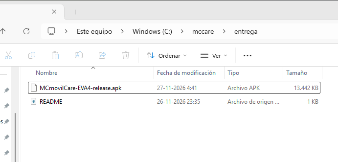
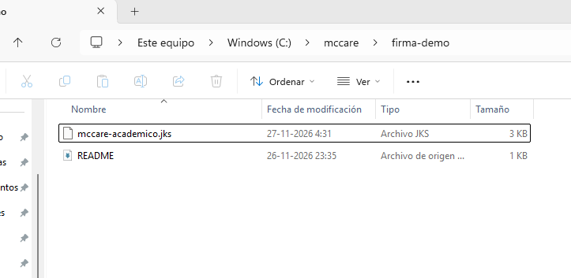
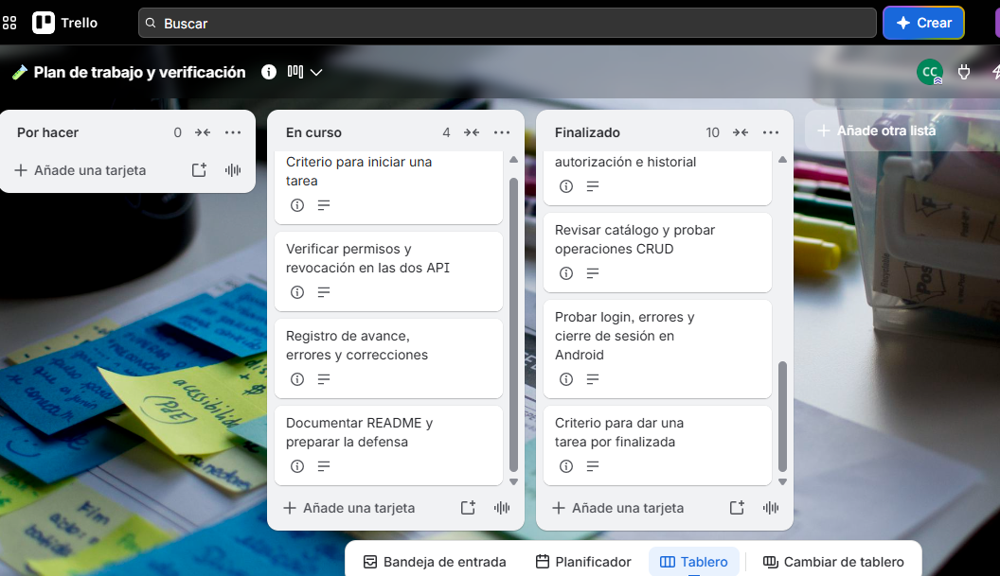

# MCmovil Care

Aplicación móvil Android para gestionar el ciclo de vida de equipos y sus atenciones técnicas. Permite registrar solicitudes, consultar diagnósticos, gestionar cotizaciones, revisar el historial y planificar mantenciones considerando los feriados de Chile.

**Versión:** 4.2 · **Asignatura:** DSY1105 – Desarrollo de Aplicaciones Móviles · Duoc UC

## Integrantes

- Camila Castillo
- Alejandrina Farias

## Funcionalidades

- Inicio de sesión y acceso diferenciado según el rol.
- Panel de inicio con resumen de equipos, atenciones y autorizaciones pendientes.
- Registro, consulta, edición y eliminación de equipos y atenciones según permisos.
- Cotizaciones, autorización o rechazo, historial, informes técnicos y garantías.
- Captura o selección de fotografías y almacenamiento de evidencias en el servidor.
- Agenda interactiva de mantenciones con feriados de Chile y sugerencia de día hábil.
- Consulta de equipos y atenciones previamente sincronizados sin conexión, con modificaciones remotas deshabilitadas.
- Perfil de contacto y preferencias almacenados localmente.

## Tecnologías y arquitectura

| Componente | Tecnología |
|---|---|
| Aplicación móvil | Kotlin, Jetpack Compose, Material 3, MVVM |
| Comunicación | Retrofit, OkHttp, JSON y API REST |
| Persistencia local | Room |
| Backend | Java 21, Spring Boot 3.5.7, Spring Data JPA |
| Persistencia en servidor | H2, una base por microservicio |
| API externa | Nager.Date |
| Pruebas | Kotest, MockK, JUnit, MockMvc, Compose UI Test y JaCoCo |
| Control de versiones | Git y GitHub |

```text
Pantallas Compose → ViewModel → CareController → Repository
                                              ├─ Room (copia local)
                                              └─ Retrofit / HTTP
                                                  ├─ Catálogo :8081 → H2
                                                  ├─ Atenciones :8082 → H2
                                                  └─ Nager.Date (feriados)
```

### Estructura del proyecto

| Ruta | Responsabilidad |
|---|---|
| `android/app/src/main/java/.../ui` | Pantallas, navegación, componentes y tema visual. |
| `android/app/src/main/java/.../viewmodel` | Estado y coordinación de acciones de la interfaz. |
| `android/app/src/main/java/.../data` | Adaptador de persistencia local con Room. |
| `logic/src/main/kotlin/com/mcmovilcare/logic/data/model` | Modelos de datos. |
| `logic/src/main/kotlin/com/mcmovilcare/logic/data/remote` | Contratos de API y configuración Retrofit. |
| `logic/src/main/kotlin/com/mcmovilcare/logic/repository` | Acceso a datos remotos y caché. |
| `logic/src/main/kotlin/com/mcmovilcare/logic/domain` | Controladores de lógica y validaciones. |
| `services/catalogo` | Microservicio de equipos y sesiones. |
| `services/atenciones` | Microservicio de atenciones y evidencias. |
| `verificacion-logica` | Ejecución Maven y cobertura de los mismos fuentes Kotlin del módulo `logic`. |
| `evidencias` | Resultados de pruebas y capturas del proyecto. |
| `tools` | Configuración del entorno utilizada por los scripts PowerShell. |

En el backend, los Controller reciben solicitudes HTTP, los Service aplican reglas de negocio, los Repository acceden a los datos mediante JPA y las Entity representan las entidades persistentes. Los filtros `AccesoFiltro` validan la sesión y restringen operaciones según el rol.

## Microservicios y endpoints

### Catálogo — `http://localhost:8081`

| Método | Endpoint | Función |
|---|---|---|
| GET | `/api/salud` | Estado del servicio. |
| POST | `/api/sesion` | Autenticar usuario y obtener token. |
| GET | `/api/sesion` | Consultar identidad de la sesión. |
| DELETE | `/api/sesion` | Revocar sesión. |
| GET | `/api/equipos` | Listar equipos. |
| GET | `/api/equipos/{id}` | Consultar equipo. |
| POST | `/api/equipos` | Crear equipo. |
| PUT | `/api/equipos/{id}` | Actualizar equipo. |
| DELETE | `/api/equipos/{id}` | Eliminar equipo sin referencias. |

### Atenciones — `http://localhost:8082`

| Método | Endpoint | Función |
|---|---|---|
| GET | `/api/salud` | Estado del servicio. |
| GET | `/api/atenciones` | Listar atenciones. |
| GET | `/api/atenciones/{id}` | Consultar atención. |
| POST | `/api/atenciones` | Crear atención. |
| PUT | `/api/atenciones/{id}` | Actualizar atención. |
| PATCH | `/api/atenciones/{id}/autorizacion` | Autorizar o rechazar cotización. |
| DELETE | `/api/atenciones/{id}` | Eliminar atención. |
| POST | `/api/evidencias` | Cargar imagen (multipart, campo `archivo`). |
| GET | `/api/evidencias/{nombre}` | Recuperar imagen. |
| GET | `/internal/equipos/{id}/en-uso` | Comprobar referencias a equipos entre servicios. |

### API externa

`GET https://date.nager.at/api/v3/PublicHolidays/{year}/CL`

Retrofit consulta los feriados del año seleccionado para identificar conflictos con mantenciones. Este servicio no modifica las bases de datos del negocio.

## Instalación y ejecución en Windows

### Requisitos

- JDK completo 21 (incluido `javac`); usar JDK 21 para Gradle.
- Android Studio compatible con AGP 8.13.2, Android SDK Platform 35, Build Tools 35.0.0 y Platform Tools.
- Emulador Android (recomendado API 35) o teléfono Android API 26 o superior con depuración USB.
- Internet para descargar dependencias inicialmente y consultar feriados. El script descarga Maven 3.9.11 si es necesario.
- Puertos locales 8081 y 8082 disponibles.

### 1. Obtener el proyecto

Descargar el ZIP completo de entrega o clonar el repositorio:

```powershell
git clone https://github.com/Cami-Castillo/MCmovil-Care-EVA3.git C:\mccare
```

Si se utiliza el ZIP, extraerlo de modo que `C:\mccare` contenga `android`, `logic`, `services`, `tools` y `pom.xml`. Se recomienda una ruta corta para evitar problemas de longitud en Windows. No abrir ni ejecutar desde dentro del ZIP.

### 2. Iniciar el backend

Abrir PowerShell en la raíz del proyecto:

```powershell
cd C:\mccare
# Solo si Windows bloquea scripts y la política del equipo lo permite:
Set-ExecutionPolicy -Scope Process Bypass
.\Iniciar-Servicios.ps1
```

Comprobar que ambos servicios estén activos:

```powershell
Invoke-RestMethod http://localhost:8081/api/salud
Invoke-RestMethod http://localhost:8082/api/salud
```

Ambos deben devolver `estado: OK`. Las bases H2 se crean automáticamente si no existen. Los datos se conservan entre reinicios en las carpetas `services/catalogo/datos` y `services/atenciones/datos`.

### 3. Ejecutar desde Android Studio

1. Seleccionar **File > Open** y abrir `C:\mccare\android` (no la raíz ni `android/app`). El módulo `logic` se incorpora automáticamente mediante `settings.gradle.kts`.
2. Seleccionar JDK 21 en Gradle JDK y esperar a que termine Gradle Sync. Si se solicita la ubicación del SDK, seleccionar el SDK instalado en ese equipo.
3. Abrir Device Manager e iniciar un emulador API 35.
4. Desde PowerShell, conectar los puertos del dispositivo con el backend:

```powershell
cd C:\mccare
.\Conectar-Dispositivo.ps1
```

5. Seleccionar la configuración `app`, el emulador y presionar **Run**. Esta opción ejecuta la versión debug y permite modificar y probar el código.

### 4. Ejecutar el APK firmado sin recompilar (alternativa)

El ZIP de entrega contiene `entrega/MCmovilCare-EVA4-release.apk`. Si se clonó el repositorio, descargar el APK desde [GitHub Releases](https://github.com/Cami-Castillo/MCmovil-Care-EVA3/releases) y guardarlo con ese nombre dentro de `entrega`.

Con los microservicios activos y el emulador encendido:

```powershell
cd C:\mccare
.\Instalar-APK.ps1
```

El script configura ADB Reverse, instala y abre la aplicación release. Si hay varios dispositivos conectados, usar `adb devices` y pasar `-Serial "SERIAL_DEL_DISPOSITIVO"` al script correspondiente.

El APK utiliza `127.0.0.1` y necesita ADB Reverse para acceder al backend del computador. Instalarlo en un teléfono sin esta conexión permite abrirlo, pero no iniciar una nueva sesión. La versión debug y release pueden coexistir.

### 5. Usuarios de demostración

| Usuario | Contraseña de demostración | Permisos principales |
|---|---|---|
| `admin` | `AdminDemo26!` | Gestionar equipos y atenciones; responder cotizaciones. |
| `cliente` | `ClienteDemo26!` | Consultar equipos y atenciones, crear solicitudes y responder cotizaciones. |
| `tecnico` | `TecnicoDemo26!` | Consultar equipos y atenciones, actualizar atenciones y adjuntar evidencias. |

Las cuentas son ficticias y comparten los registros del backend. Catálogo genera un token aleatorio de sesión de ocho horas (no JWT), que se envía mediante `Authorization: Bearer ...`. Reiniciar Catálogo requiere iniciar sesión nuevamente.

### 6. Detener los servicios

```powershell
cd C:\mccare
.\Detener-Servicios.ps1
```

Si un puerto aparece ocupado, comprobar primero `/api/salud`. Si el servicio pertenece al proyecto, utilizar el script de detención antes de reiniciarlo. Si falla el arranque, revisar `logs/catalogo.log`, `logs/atenciones.log` y sus respectivos archivos de error. No eliminar bases de datos para resolver problemas de conexión.

## Pruebas y cobertura

Detener los microservicios antes de ejecutar Maven para evitar el bloqueo de archivos JAR en Windows. Desde la raíz:

```powershell
.\Ejecutar-Pruebas.ps1
```

Para incluir las pruebas instrumentadas, iniciar el emulador y ejecutar:

```powershell
.\Ejecutar-Pruebas.ps1 -ConInterfaz
```

Resultados registrados el 27 de noviembre de 2026:

| Verificación | Resultado |
|---|---|
| ControllerTest | 19/19 |
| LoginTest | 4/4 |
| RepositoryTest | 7/7 |
| ValidacionTest | 35/35 |
| Total pruebas de lógica | 65/65 |
| Pruebas instrumentadas (Pixel 7, Android 15) | 10/10 |
| Comprobaciones HTTP sin sesión y por rol | 15/15 |
| Compilación y pruebas Maven | Catálogo, Atenciones y lógica: SUCCESS |

| Módulo JaCoCo (Maven) | Instrucciones | Líneas | Ramas |
|---|---:|---:|---:|
| Lógica | 97% | 94,44% | 93% |
| Catálogo | 94% | 96,12% | 79% |
| Atenciones | 95% | 93,71% | 78% |

La cobertura corresponde al código analizado, con exclusiones de modelos y clases sin reglas según la configuración; no representa la totalidad de Android. El paquete `data.remote` del informe lógico registra 0% de instrucciones. Las comprobaciones HTTP verifican restricciones generales, no una auditoría integral de seguridad.

Informes generados:

- `verificacion-logica/target/site/jacoco/index.html`
- `services/catalogo/target/site/jacoco/index.html`
- `services/atenciones/target/site/jacoco/index.html`
- `logic/build/reports/jacoco/test/html/index.html`
- `android/app/build/reports/androidTests/connected/debug/index.html`

[Consultar evidencias de pruebas y firma](evidencias/EvidenciasPruebas.docx).

## APK firmado

La versión 4.2 fue compilada en modo release, firmada con una llave académica JKS (alias `mccare`) y verificada mediante `apksigner`. Firma APK v2, RSA 2048 bits. Se instaló y se comprobó el funcionamiento conectado a los microservicios en un emulador Pixel 7 con Android 15.

[Descargar APK en GitHub Releases](https://github.com/Cami-Castillo/MCmovil-Care-EVA3/releases)

### Reconstruir la versión release

No es necesario para ejecutar el APK existente. Para generar otra versión firmada, disponer de la llave y crear `android/keystore.properties` a partir de `android/keystore.properties.example`, completando las credenciales de forma privada. La configuración de firma se encuentra en `android/app/build.gradle.kts`.

Con los servicios detenidos y la configuración de firma preparada:

```powershell
cd C:\mccare
New-Item -ItemType Directory -Path .\entrega -Force | Out-Null
.\Generar-Release.ps1
```

El APK queda en `entrega/MCmovilCare-EVA4-release.apk`. La llave privada y sus contraseñas no deben publicarse en GitHub. Para la entrega académica, se proporcionan únicamente mediante el canal privado autorizado.

**APK generado**



**Llave JKS**



## Organización del trabajo

El repositorio registra el historial de cambios del proyecto. La captura de Trello documenta el estado de las tareas al cierre del desarrollo.



## Alcance

Proyecto académico con datos ficticios. Los servicios se ejecutan localmente y no se conectan a Gestioo. No incluye registro dinámico de usuarios, aislamiento de datos entre clientes reales ni sincronización de escrituras offline. No utilizar datos personales reales ni desplegar las credenciales de demostración en producción.
